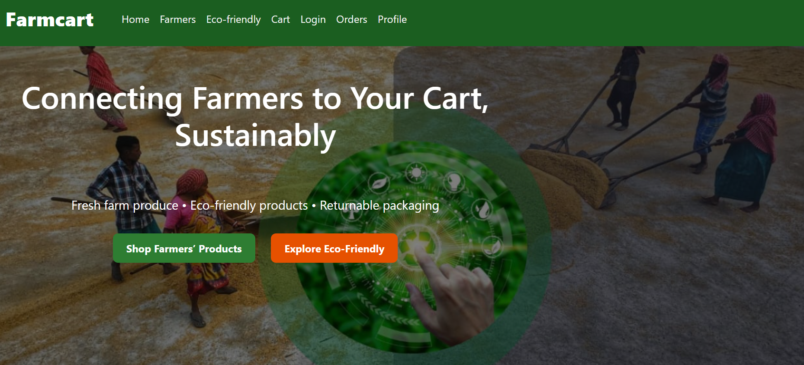
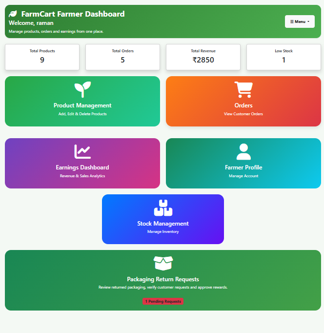
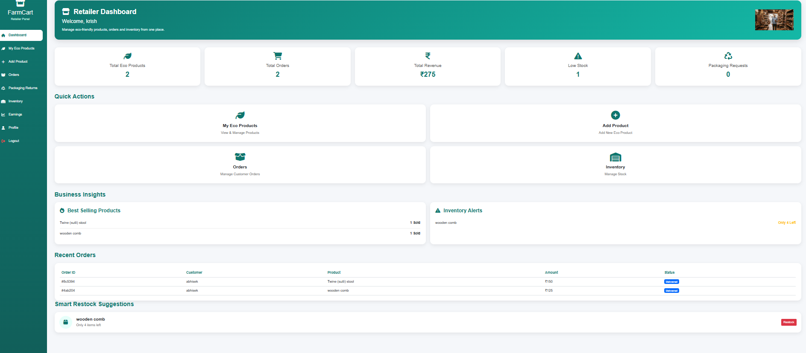
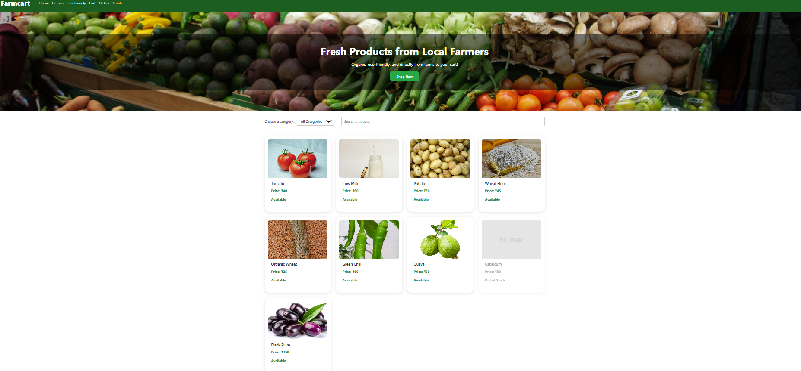
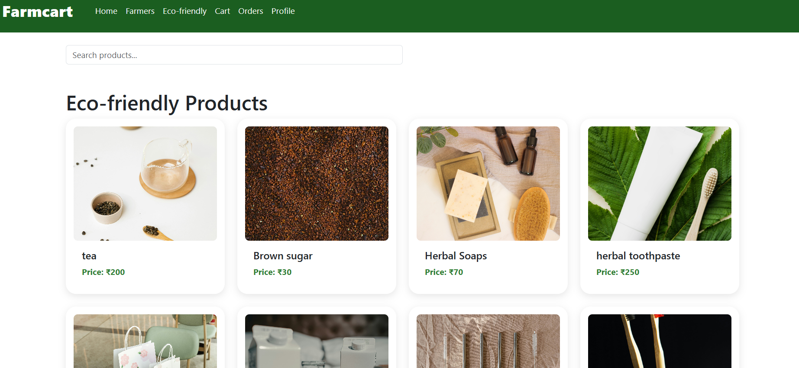

# FarmCart – Connecting Farmers to Your Cart, Sustainably

## About the Project

FarmCart is a web-based agricultural marketplace developed to connect farmers, customers, and retailers through a single platform.

The application allows customers to explore agricultural products, browse eco-friendly products, add products to their cart, and place orders. Farmers can manage their product listings, while retailers can manage eco-friendly products.

FarmCart also introduces a returnable packaging concept to encourage sustainable shopping practices and reduce packaging waste.

## Key Features

### 1. User Management
- User registration and login.
- Separate dashboards for different user roles.
- JWT-based authentication.

### 2. Farmer Marketplace
- Browse agricultural products listed by farmers.
- Add and manage product listings.
- Manage product stock and availability.
- Farmer dashboard.

### 3. Customer Features
- Browse and search products.
- View product details.
- Add products to the shopping cart.
- Place orders.
- View order-related information.
- Customer dashboard.

### 4. Eco-Friendly Marketplace
- Dedicated section for eco-friendly products.
- Browse eco-friendly products.
- Retailer dashboard.
- Retailer product and inventory management.

### 5. Sustainable Packaging
- Returnable packaging concept.
- Packaging return and deposit/refund-related functionality.

## Technology Stack

FarmCart is developed using the following technologies:

| Category | Technologies |
|---|---|
| Frontend | HTML, CSS, JavaScript, Bootstrap |
| Backend | Node.js, Express.js |
| Database | MongoDB, Mongoose |
| Authentication | JSON Web Token (JWT), bcryptjs |
| Templating | EJS |
| File Uploads | Multer |


## Project Structure

```text
FarmCart/
│
├── frontend/
│   ├── css/
│   │   └── style.css
│   ├── js/
│   ├── images/
│   ├── index.html
│   ├── login.html
│   ├── signup.html
│   ├── farmers.html
│   ├── products.html
│   ├── cart.html
│   ├── farmer-dashboard.html
│   ├── retailer-dashboard.html
│   └── admin-dashboard.html
│
├── models/
│   ├── user.js
│   ├── product.js
│   ├── cart.js
│   ├── order.js
│   ├── delivery.js
│   ├── reviews.js
│   ├── packagingReturn.js
│   └── RewardWallet.js
│
├── views/
│   ├── cart/
│   ├── orders/
│   ├── products/
│   └── userlisting/
│
├── init/
│   ├── data.js
│   ├── deliverydata.js
│   ├── orderdata.js
│   ├── productdata.js
│   └── index.js
│
├── util/
│   └── demouser.js
│
├── uploads/
│
├── app.js
├── package.json
├── package-lock.json
├── migrateSellers.js
├── .gitignore
└── README.md
```


## Installation & Setup

Follow these steps to set up FarmCart on your local system.

### Prerequisites

Make sure the following software is installed:

- Node.js
- MongoDB
- Git

### Steps

**1. Clone the repository**

```bash
git clone https://github.com/YOUR_USERNAME/FarmCart.git
```

**2. Navigate to the project directory**

```bash
cd FarmCart
```

**3. Install project dependencies**

```bash
npm install
```

**4. Configure environment variables**

Create a `.env` file in the root directory and configure the required variables.

**5. Start the application**

```bash
node app.js
```

**6. Open the application**

Visit the following URL in your browser:

```text
http://localhost:8080
```


## Screenshots

### Homepage


### Farmer Dashboard


### Retailer Dashboard


### Farmer Products


### Eco-Friendly Products



## Environment Variables

FarmCart uses environment variables to manage sensitive configuration.

Create a `.env` file in the root directory of the project.

Add the following variable:

```env
JWT_SECRET=your_jwt_secret_key
```

Replace `your_jwt_secret_key` with a strong, private secret key.

**Important:**
- Keep your `.env` file private.
- Never upload your actual secret key to GitHub.
- The `.env` file is excluded from version control using `.gitignore`.


## How to Run

Follow these steps to run FarmCart locally:

**1. Start MongoDB**

Make sure your MongoDB service is running on your system.

**2. Open the project directory**

Open the FarmCart project folder in your terminal.

**3. Start the Node.js server**

```bash
node app.js
```

**4. Access the application**

Open your browser and visit:

http://localhost:8080

The FarmCart application will be available locally.


## Future Enhancements

The following features can be added to improve FarmCart in the future:

- **Progressive Web App (PWA):** Enable app-like experience and offline access.
- **Location-Based Discovery:** Help customers find nearby farmers and products.
- **Regional Language Support:** Add Hindi and other regional languages for better accessibility.
- **Weather Alerts:** Provide farmers with useful weather-related notifications.
- **Improved User Experience:** Develop simpler and more accessible interfaces for farmers.
- **Smart Inventory Management:** Introduce better stock monitoring and restocking suggestions.


## Project Purpose

FarmCart was developed to create a digital platform that connects farmers, customers, and retailers in one place.

The main objective is to make agricultural products more accessible while encouraging sustainable shopping practices.

Through FarmCart, the project aims to:

- Provide farmers with an online platform to showcase their products.
- Make it easier for customers to discover and purchase agricultural products.
- Support retailers in managing eco-friendly products.
- Encourage sustainable practices through the returnable packaging concept.

This project was developed as a practical application of web development technologies and backend development concepts.

